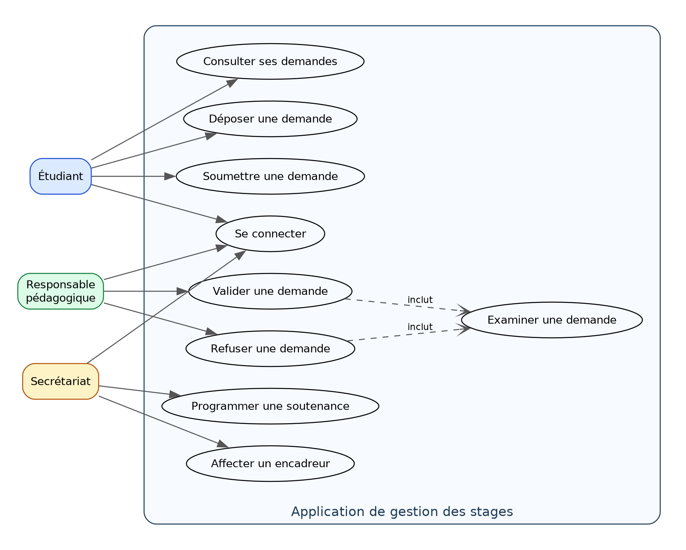

# Diagramme de cas d'utilisation — trois acteurs

**Consigne 1 du TP3 :** dessiner le diagramme de cas d'utilisation pour **trois acteurs**.



## Acteurs

| Acteur | Rôle | Cas d'utilisation |
|---|---|---|
| **Étudiant** | Dépose et suit son dossier de stage | Se connecter, déposer, soumettre, consulter |
| **Responsable pédagogique** | Instruit et décide | Se connecter, examiner, valider, refuser |
| **Secrétariat** | Organise après décision | Se connecter, affecter un encadreur, programmer une soutenance |

Le diagramme comporte **exactement trois acteurs**. L'encadreur et l'administrateur ne font pas
partie de ce TP.

## Cas d'utilisation et exigences

| Cas d'utilisation | Acteur principal | Exigence | Résultat attendu |
|---|---|---|---|
| Se connecter | Les trois | EF-01 | Session ouverte, rôle connu |
| Déposer une demande | Étudiant | EF-02 | Demande créée en `BROUILLON` |
| Soumettre une demande | Étudiant | EF-02 | Passage `BROUILLON → SOUMISE` |
| Consulter ses demandes | Étudiant | EF-02 | Liste limitée à ses propres dossiers |
| Examiner une demande | Responsable | EF-03 | Dossier `SOUMISE` consulté |
| Valider une demande | Responsable | EF-03 | Statut `VALIDEE` |
| Refuser une demande | Responsable | EF-03 | Statut `REFUSEE` + motif obligatoire |
| Affecter un encadreur | Secrétariat | EF-04 | `encadreur_id` renseigné |
| Programmer une soutenance | Secrétariat | EF-05 | Créneau réservé sans conflit |

Les cas « Valider » et « Refuser » incluent « Examiner » : le responsable consulte toujours le
dossier avant de décider.

## Source du diagramme

Le fichier Graphviz modifiable est `sources/cas_utilisation.dot`. Il se régénère avec :

```bash
dot -Tpng -Gdpi=180 sources/cas_utilisation.dot -o 01_diagramme_cas_utilisation.png
```
