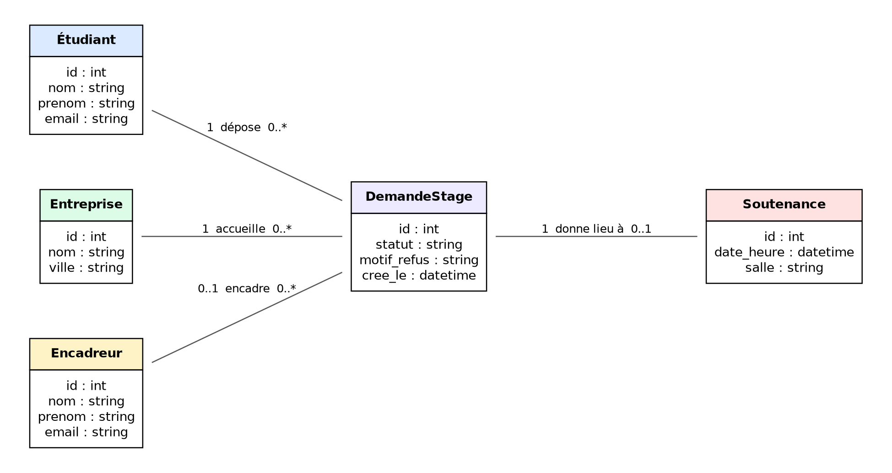

# Diagramme de classes — cinq classes

**Consigne 2 du TP3 :** dessiner le diagramme de classes avec multiplicités pour **Étudiant,
Entreprise, DemandeStage, Encadreur, Soutenance**.



## Classes du modèle

| Classe | Rôle | Attributs principaux |
|---|---|---|
| `Étudiant` | Auteur du dossier | `id`, `nom`, `prenom`, `email` |
| `Entreprise` | Organisme d'accueil | `id`, `nom`, `ville` |
| `Encadreur` | Encadrant pédagogique | `id`, `nom`, `prenom`, `email` |
| `DemandeStage` | Dossier de stage | `id`, `statut`, `motif_refus`, `cree_le` |
| `Soutenance` | Présentation finale | `id`, `date_heure`, `salle` |

Le diagramme contient **exactement ces cinq classes**.

## Multiplicités et justification

| Association | Multiplicités | Justification | Traduction SQL |
|---|---|---|---|
| Étudiant — DemandeStage | `1` — `0..*` | Un étudiant peut déposer plusieurs demandes ; chaque demande appartient à un seul étudiant | `demande_stage.etudiant_id INT NOT NULL` + FK |
| Entreprise — DemandeStage | `1` — `0..*` | Une entreprise accueille plusieurs demandes ; chaque demande vise une seule entreprise | `demande_stage.entreprise_id INT NOT NULL` + FK |
| Encadreur — DemandeStage | `0..1` — `0..*` | Une demande reçoit au plus un encadreur, après validation ; un encadreur suit plusieurs demandes | `demande_stage.encadreur_id INT NULL` + FK |
| DemandeStage — Soutenance | `1` — `0..1` | Une demande a au plus une soutenance ; une soutenance concerne une seule demande | `soutenance.demande_id INT NOT NULL UNIQUE` + FK |

## Réponse à la question du cours

La multiplicité « une demande a au plus une soutenance » se traduit par une colonne `demande_id`
**non nulle et `UNIQUE`** dans la table `soutenance` :

```sql
demande_id INT NOT NULL UNIQUE
```

- La **clé étrangère** garantit que la soutenance référence une demande existante.
- Le **`UNIQUE`** garantit qu'une même demande ne peut pas avoir deux soutenances.

## Source du diagramme

Le fichier Graphviz modifiable est `sources/classes.dot`. Il se régénère avec :

```bash
dot -Tpng -Gdpi=180 sources/classes.dot -o 02_diagramme_classes.png
```
