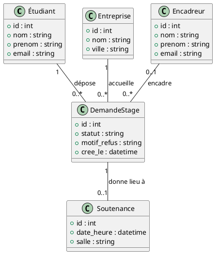

# Faire le diagramme de classes dans Astah

**Astah UML 11 ou 12** · Plugin PlantUML · 5 classes · multiplicités conformes au TP3



## 1. Installer le plugin PlantUML dans Astah

Le plugin est déjà téléchargé dans ce dossier :

```text
outils/astah-plantuml-plugin-1.1.0.jar
```

Cette version **1.1.0** est compatible avec **Astah UML 11.0 et 12.x**. Pour Astah 12, la version
1.3.0 est aussi disponible sur le site officiel.

### Installation

1. Lancez **Astah UML**.
2. Glissez-déposez `outils/astah-plantuml-plugin-1.1.0.jar` dans la fenêtre Astah.
3. Acceptez l’installation, puis **redémarrez Astah**.
4. Ouvrez un projet : `Fichier` → `Nouveau`.
5. Affichez le panneau : `Affichage` → `Afficher/Masquer la vue supplémentaire`.
6. En bas à droite, ouvrez l’onglet **PlantUML View**.

Si l’onglet apparaît avec un éditeur à gauche et un aperçu à droite, le plugin est installé.

## 2. Importer le diagramme

1. Ouvrez `TP3_classes_astah.puml` avec un éditeur de texte.
2. Copiez **tout** le contenu, de `@startuml` à `@enduml`.
3. Collez-le dans l’éditeur **PlantUML View** d’Astah.
4. Cliquez sur le bouton **▲ toAstah**.
5. Astah crée un nouveau diagramme de classes avec les 5 classes et les 4 associations.

## 3. Vérifier le diagramme

Le diagramme doit contenir exactement :

| Classe | Attributs |
|---|---|
| `Étudiant` | `id`, `nom`, `prenom`, `email` |
| `Entreprise` | `id`, `nom`, `ville` |
| `Encadreur` | `id`, `nom`, `prenom`, `email` |
| `DemandeStage` | `id`, `statut`, `motif_refus`, `cree_le` |
| `Soutenance` | `id`, `date_heure`, `salle` |

Et les multiplicités suivantes :

| Association | Multiplicités |
|---|---|
| Étudiant — DemandeStage | `1` — `0..*` |
| Entreprise — DemandeStage | `1` — `0..*` |
| Encadreur — DemandeStage | `0..1` — `0..*` |
| DemandeStage — Soutenance | `1` — `0..1` |

Vérifiez surtout le côté **Soutenance** : `DemandeStage "1" -- "0..1" Soutenance`.
C’est la traduction UML de la contrainte SQL `soutenance.demande_id NOT NULL UNIQUE`.

## 4. Enregistrer et exporter

1. `Fichier` → `Enregistrer sous` → `TP3_classes.asta`.
2. Pour une image : clic droit sur l’onglet du diagramme → `Exporter l’image` (ou
   `Fichier` → `Exporter` → `Image`), puis choisissez **PNG** ou **SVG**.
3. Pour un PDF : `Fichier` → `Exporter` → `PDF`.

Astah peut aussi exporter toutes les images en ligne de commande :

```bash
# Windows
astah-commandw.exe -image cl -f TP3_classes.asta -o export -t png

# Linux / macOS
astah-command.sh -image cl -f TP3_classes.asta -o export -t png
```

## 5. Si le plugin ne fonctionne pas

- Vérifiez la version d’Astah : le plugin 1.1.0 exige Astah **11.0 ou plus**.
- Sur Linux, installez **Graphviz** (`dot`) : le plugin en a besoin pour les diagrammes de classes.
- Si l’aperçu reste vide, fermez et relancez Astah après l’installation du plugin.
- Vous pouvez aussi créer le diagramme à la main dans Astah : les 5 classes et les 4 associations
  sont listées dans le tableau ci-dessus.
