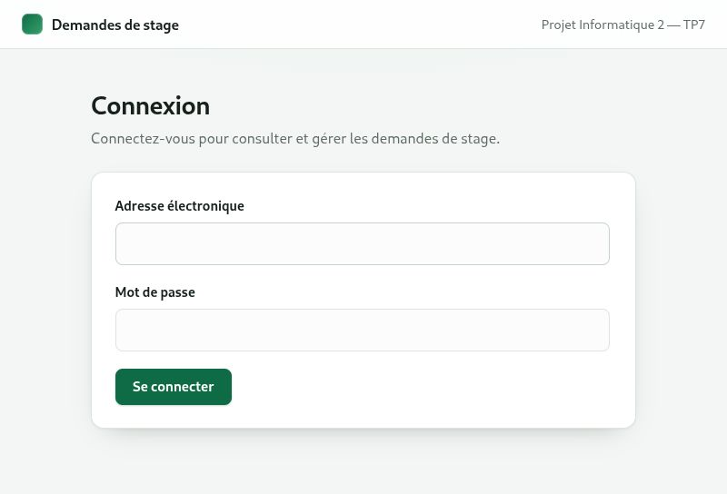
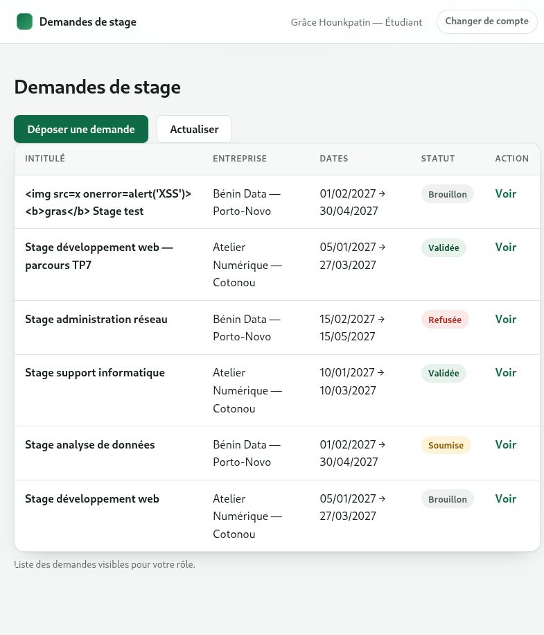
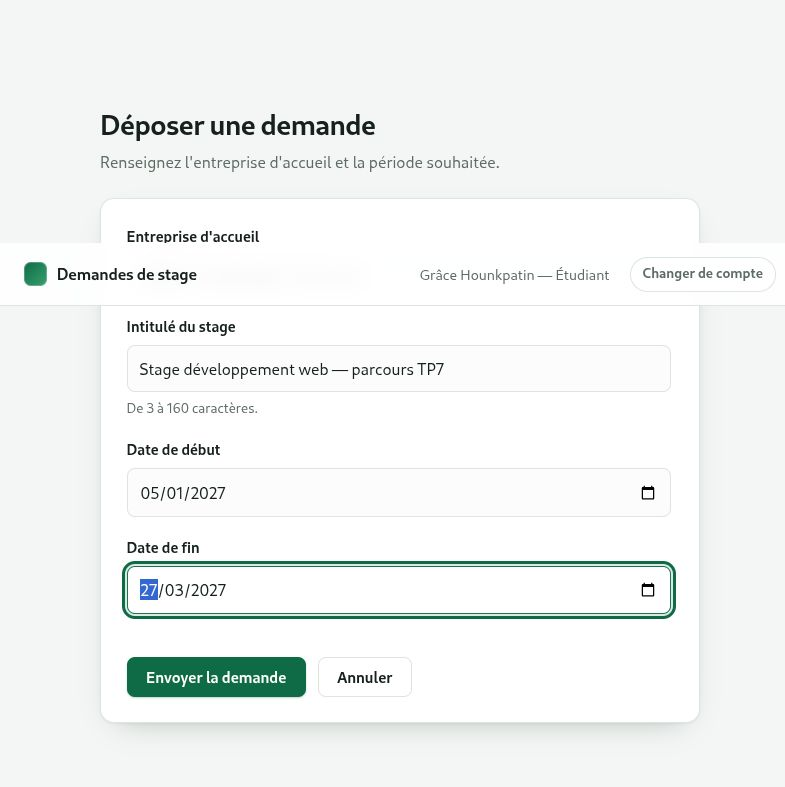
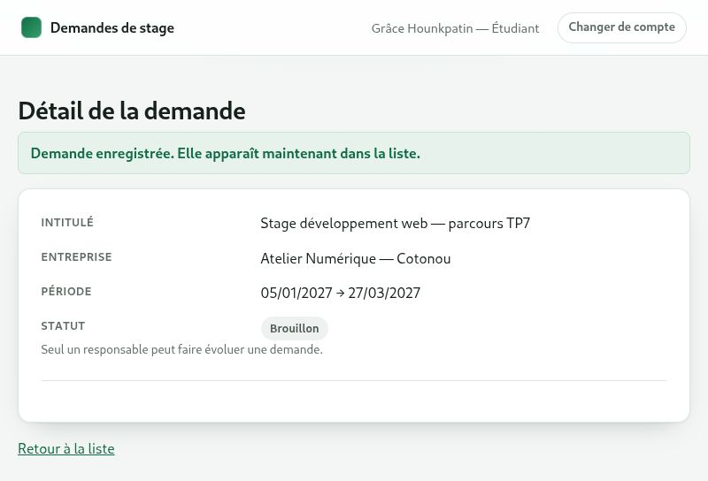
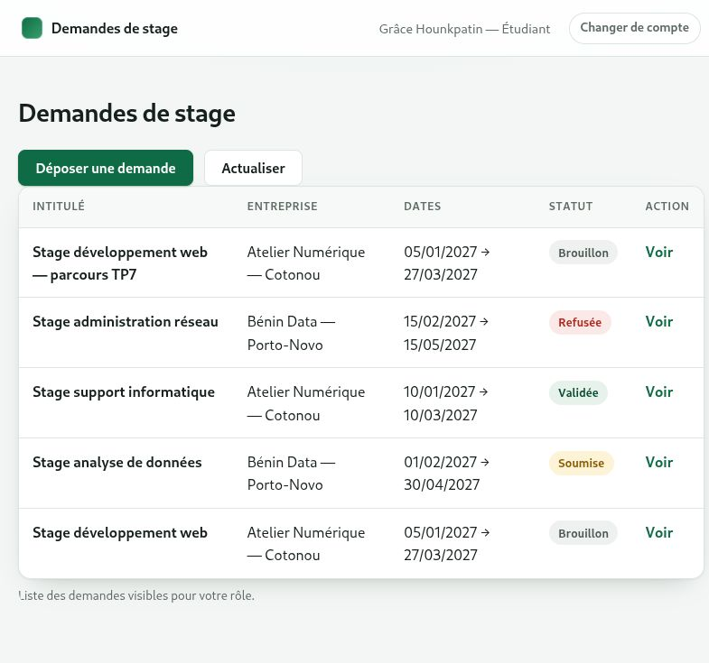
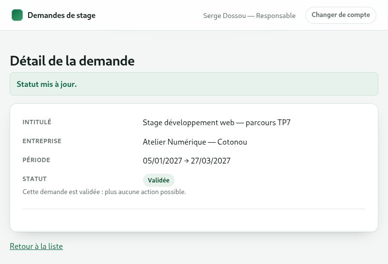
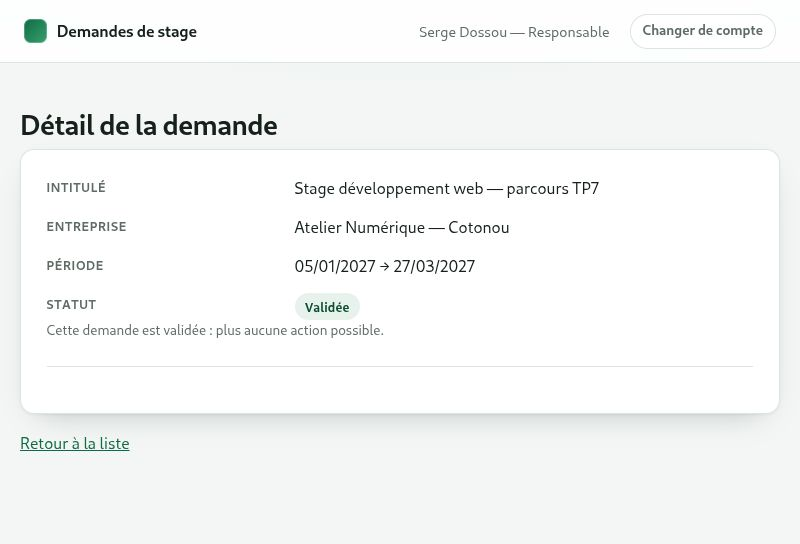
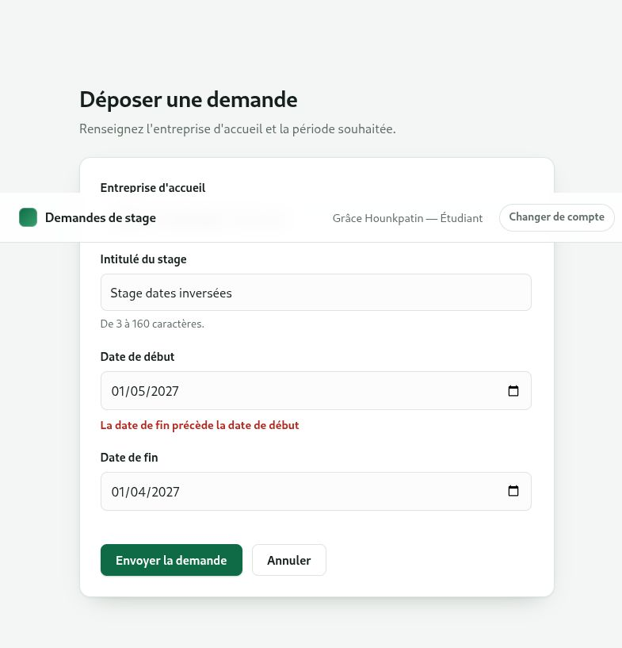
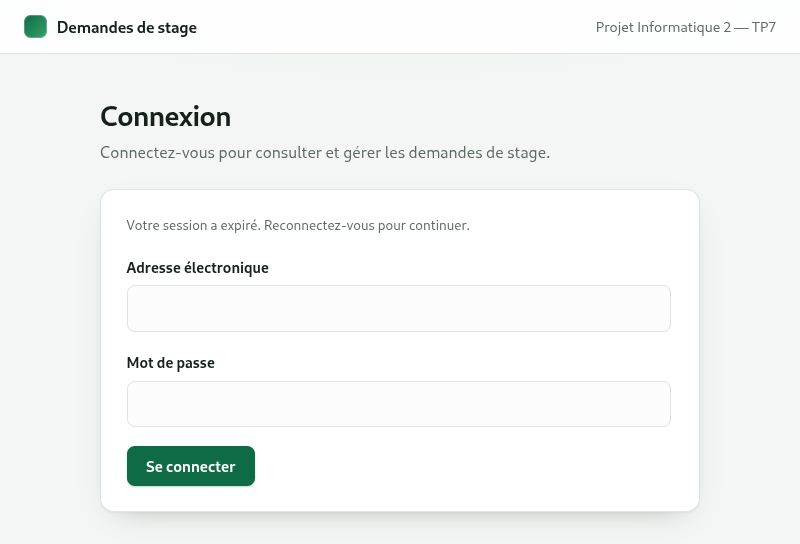
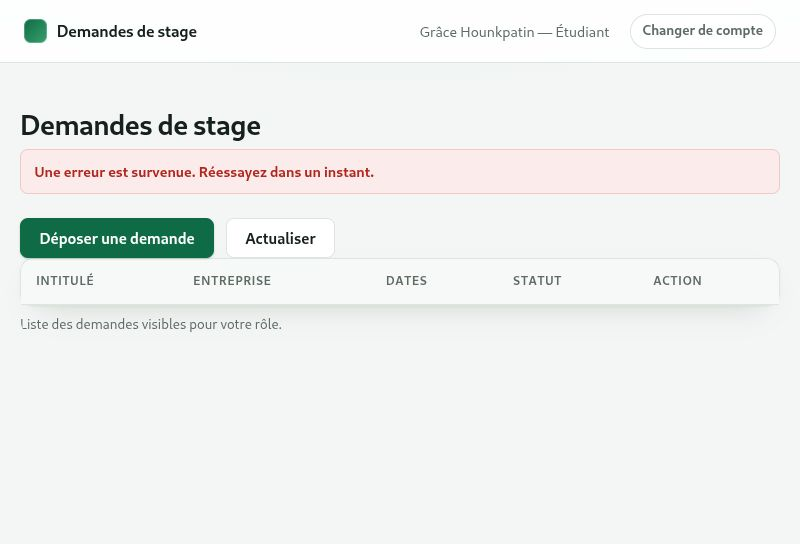

# TP7 — Interface et intégration

Les pages Web de ce dossier parlent à l'API des demandes réalisée au TP6.
Tout est en HTML, CSS et JavaScript simple : aucun framework, aucune compilation.
Les personnes, entreprises et villes du jeu d'essai sont fictives et situées au Bénin.

## Compte
Etudiant : etudiant@exemple.test / etudiant123, 
Responsable : responsable@exemple.test / responsable123

## 1. Les pages

| Page | Rôles | Rôle de la page |
|---|---|---|
| `connexion.html` | tous | Saisir son adresse et son mot de passe. |
| `demandes.html` | tous | Lister les demandes visibles : l'étudiant ne voit que les siennes, le responsable voit tout. |
| `depot.html` | étudiant | Déposer une demande : entreprise, intitulé, dates. |
| `detail.html` | tous | Consulter une demande. Le responsable y valide, refuse ou remet en brouillon. |

Chaque page utilise un en-tête commun : nom et rôle de la personne connectée, et
lien « Changer de compte ».



## 2. Parcours des deux rôles

**Étudiant** : connexion → liste de ses demandes → dépôt → détail de la demande créée.

**Responsable** : connexion → liste de toutes les demandes → détail → décision
(valider, refuser avec motif, ou remettre en brouillon).

Les boutons de décision suivent la table des transitions de l'API :

| Statut affiché | Actions proposées au responsable |
|---|---|
| Brouillon | Soumettre la demande |
| Soumise | Valider / Refuser (motif obligatoire) |
| Refusée | Remettre en brouillon |
| Validée | Aucune |

## 3. Test des balises (rendu sécurisé)

Un intitulé contenant du HTML a été saisi dans le formulaire de dépôt :

```text
 <b>gras</b> Stage test
```

La demande est créée (HTTP 201), puis la liste l'affiche **littéralement** : aucune
balise n'est interprétée, aucune alerte ne s'ouvre.



Mesures relevées dans la page :

```text
document.querySelectorAll('img').length   = 0
document.querySelectorAll('b').length     = 0
innerHTML contient &lt;img                = true
textContent de la cellule                 = " <b>gras</b> Stage test"
boîte de dialogue                         = aucune
```

Le détail des requêtes et des valeurs est dans [`preuves/test_balises.txt`](preuves/test_balises.txt).
Tout le contenu vient de `textContent` : `innerHTML` n'est jamais utilisé pour des données.

## 4. Scénario de bout en bout

### Étape 1 — Connexion de l'étudiante

Grâce Hounkpatin se connecte avec `etudiant@exemple.test`. L'API répond `200` et la page
ouvre la liste de ses demandes.

### Étape 2 — Dépôt d'une demande

Formulaire rempli : Atelier Numérique — Cotonou, « Stage développement web — parcours TP7 »,
du 05/01/2027 au 27/03/2027.



### Étape 3 — La demande est créée et retrouvée

`POST /api/demandes` répond `201` avec la demande créée. La page ouvre aussitôt son
détail : statut **Brouillon**, aucune action possible pour une étudiante.



### Étape 4 — Elle apparaît dans la liste



### Étape 5 — Validation par le responsable

Serge Dossou se connecte, ouvre la demande, la soumet (`BROUILLON → SOUMISE`) puis la
valide (`SOUMISE → VALIDEE`). Chaque appel répond `200`.



### Étape 6 — Rafraîchissement et persistance

La page est rechargée : la demande est toujours **Validée**. La donnée vient de la base,
pas de la mémoire du navigateur.



Vérification directe en base :

```text
id  statut    intitule
5   VALIDEE   Stage développement web — parcours TP7
```

## 5. Erreurs affichées

Le formulaire et les pages affichent les erreurs de l'API au bon endroit, en français,
sans jamais montrer de détail technique.

**400 — données refusées par le serveur.** Dates inversées : le message du serveur
apparaît sous les dates. C'est bien l'API qui tranche, pas le navigateur.



**401 — session absente ou expirée.** La liste renvoie vers la connexion avec un message
clair, au lieu d'une page vide.



**500 — panne du serveur.** Base arrêtée volontairement : message neutre, aucune fuite
d'information.



## 6. Lancer le projet en local

Les pages et l'API doivent être servies par la **même origine** (sinon le cookie de
session et les appels `fetch` sont bloqués).

### 6.1 Base de données

MariaDB démarrée, créer la base et l'utilisateur (une seule fois) :

```sql
CREATE DATABASE tp6_stages CHARACTER SET utf8mb4;
CREATE USER 'tp6_app'@'127.0.0.1' IDENTIFIED BY 'tp6_mot_de_passe';
GRANT ALL PRIVILEGES ON tp6_stages.* TO 'tp6_app'@'127.0.0.1';
```

Puis charger le schéma et le jeu d'essai du TP6 :

```bash
mysql -h 127.0.0.1 -u tp6_app -p tp6_stages < TP6/config/schema.sql
mysql -h 127.0.0.1 -u tp6_app -p tp6_stages < TP6/config/seed.sql
```

### 6.2 Configuration de l'API

Créer `TP6/.env` (adaptez le port : `3306` par défaut, `3307` dans notre environnement) :

```bash
cat > TP6/.env <<'ENV'
DB_HOST=127.0.0.1
DB_PORT=3307
DB_NAME=tp6_stages
DB_USER=tp6_app
DB_PASSWORD=tp6_mot_de_passe
ENV
```

Sans ce fichier, l'API ne trouve pas la base et la connexion affiche
« Une erreur est survenue ».

### 6.3 Pages, routeur et serveur

```bash
# Copier les pages dans le dossier public/ de l'API
# (travaillez sur une copie si vous voulez garder le dossier TP6 intact)
cp -r TP7/pages/. TP6/public/

# Créer un routeur qui laisse passer les fichiers existants
cat > TP6/public/routeur.php <<'PHP'
<?php
$chemin = parse_url($_SERVER['REQUEST_URI'], PHP_URL_PATH) ?: '/';
$fichier = __DIR__ . $chemin;

if ($chemin !== '/' && is_file($fichier) && $fichier !== __FILE__) {
    return false;                       // page, CSS ou JS : servi tel quel
}

if ($chemin === '/') {
    header('Location: /connexion.html');
    exit;
}

require __DIR__ . '/index.php';         // tout le reste part vers l'API
PHP

# Démarrer (API et pages sur le même serveur)
cd TP6
php -S localhost:8000 -t public public/routeur.php
```

Ouvrir ensuite <http://localhost:8000/>.

Comptes du jeu d'essai :

| Rôle | Adresse | Mot de passe |
|---|---|---|
| Étudiant | `etudiant@exemple.test` | `etudiant123` |
| Responsable | `responsable@exemple.test` | `responsable123` |

## 7. Limites connues

- L'API n'a pas de route de déconnexion : « Changer de compte » ouvre la connexion, et
  une nouvelle connexion remplace la session courante.
- L'API ne renvoie que `entreprise_id` : les noms d'entreprises sont repris du jeu
  d'essai dans `assets/api.js`.
- L'API n'expose pas `GET /api/demandes/{id}` : la page de détail lit la liste autorisée
  et y retrouve la demande.
